  

  

  
  

  
  

  

  

  <picture>
    <source media="(prefers-color-scheme: dark)" srcset="https://raw.githubusercontent.com/QDeinmaar/QDeinmaar/output/snake-dark.svg">
    <source media="(prefers-color-scheme: light)" srcset="https://raw.githubusercontent.com/QDeinmaar/QDeinmaar/output/snake.svg">
    
  </picture>

  

<!--
Add when you have them:
- Writeups blog
- Hack The Box: https://app.hackthebox.com/profile/<id>
- TryHackMe:    https://tryhackme.com/p/<username>
Everything published here is for learning and authorized testing only.
-->
